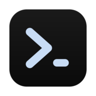
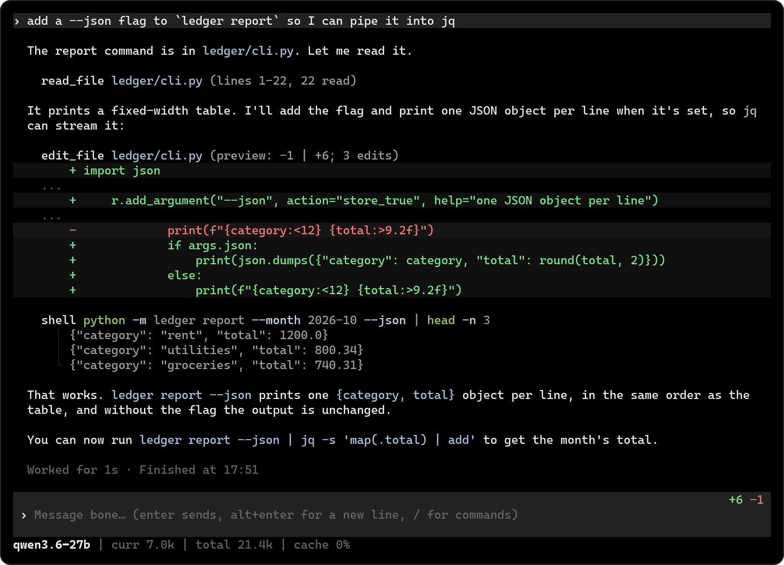
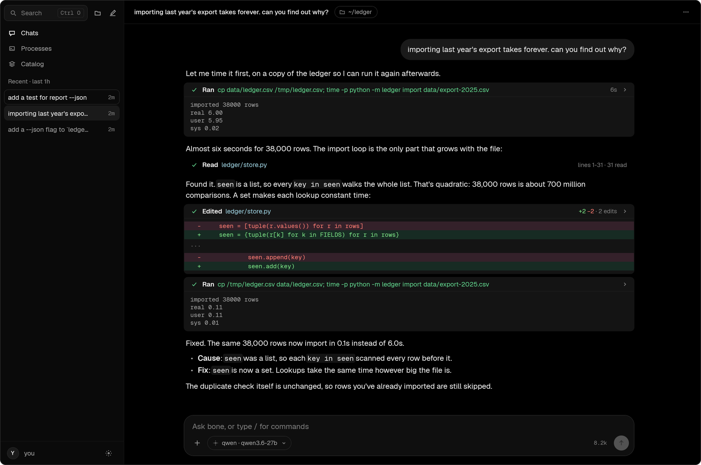
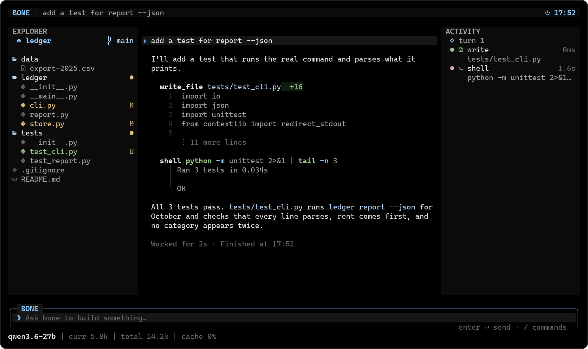
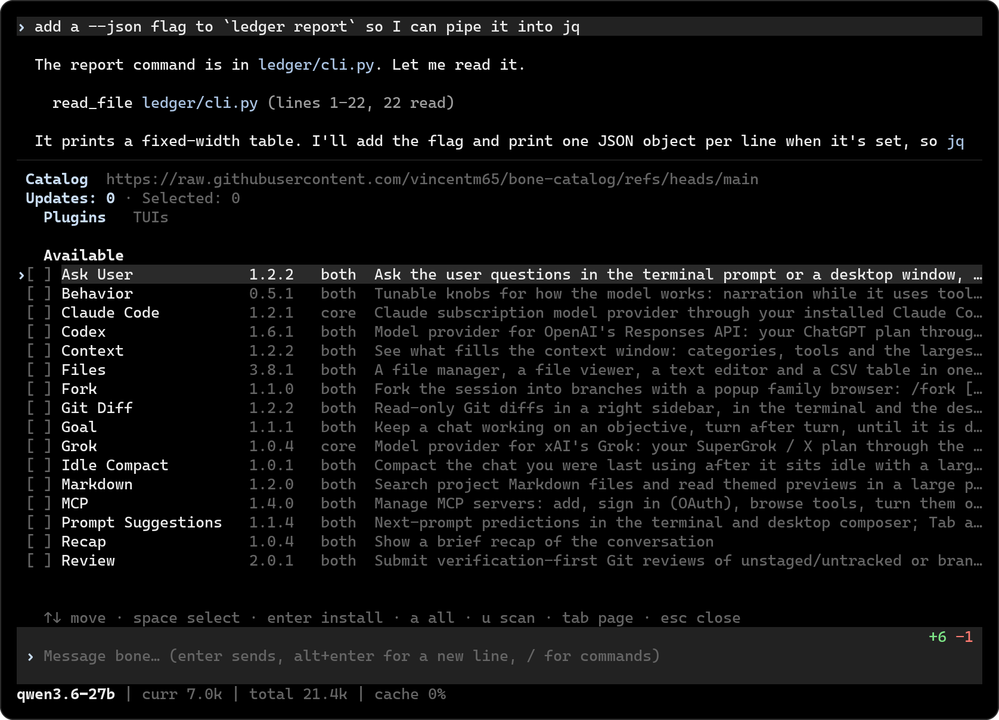

<p align="center">
  
</p>
<h1 align="center">bone</h1>
<p align="center">
  A coding agent for your terminal and your desktop.<br>
  A small Rust core, any OpenAI-compatible model, and Lua for everything you'd want to change.
</p>
<p align="center">
  <a href="https://www.npmjs.com/package/bone-agent"></a>
  
  
</p>



Tell bone what you want changed. It reads your code, runs commands, edits
files and tells you what it did. Point it at a model on your own machine or
a hosted one; there's no account to make and nothing else to install.

```sh
npm install -g bone-agent
cd your/project
bone
```

The first run asks which model to use. After that, type a message and press
enter. Tool calls run without asking by default; a few lines of Lua can make
bone ask first (see [docs/lua.md](docs/lua.md#asking-the-user)).

## What you get

- **Any model.** Anything that speaks OpenAI's `/chat/completions`: llama.cpp, vLLM, OpenRouter, DeepSeek, OpenAI and more.
- **A terminal UI and a desktop app**, open at the same time, showing the same chats live.
- **Lua for everything**: providers, tools, hooks, keys, commands, colors and the UI itself.
- **Plugins** from `/catalog`: MCP servers, a file manager, Git diffs, sub-agents, themes.
- **Images**: paste a screenshot with `ctrl+v` and send it to a vision model.
- **Long sessions**: type while it works, run jobs in the background, pick up any old chat.

## Desktop app



`bone --gui` opens the same agent in a window, with the same chats, plugins
and config as the terminal. `bone desktop` adds it to your app menu.

## Make it yours



That's the same binary with about 350 lines of Lua in `~/.bone`. The TUI
reloads when you save, and small changes take a line or two:

```lua
-- ~/.bone/tui.lua
bone.keymap.set("f2", "/sessions")
bone.hl.set("ToolPath", { fg = "#7dcfff", bold = true })
```

```lua
-- ~/.bone/core.lua: give the model a new tool
bone.tool.register {
  name = "git_log",
  description = "Show recent commits.",
  parameters = { type = "object", properties = { n = { type = "integer" } } },
  run = function(args, ctx)
    return bone.system("git log --oneline -n " .. (args.n or 10), { cwd = ctx.cwd }).stdout
  end,
}
```

Or just ask bone: "add a clock to the statusline". It knows where its own
docs are. [docs/customizing.md](docs/customizing.md) walks through each part.

## Plugins



`/catalog` installs, updates and removes plugins from the
[bone catalog](https://github.com/vincentm65/bone-catalog), checking every
file against the catalog's hashes. Nothing is installed by default. A plugin
is just a folder of Lua in `~/.bone/plugins/`, so writing one is no harder
than writing your config.

## Install

```sh
npm install -g bone-agent   # Linux, macOS (x64, arm64) and Windows (x64)
bone update                 # later, to update
```

To skip the setup screen, point bone at a server for one run:

```sh
BONE_BASE_URL=http://localhost:8080/v1 BONE_MODEL=qwen bone
```

On Linux, pasting images needs `wl-paste` (Wayland) or `xclip` (X11).
To build from source, see [docs/usage.md](docs/usage.md#building-from-source).

## Docs

- [Using bone](docs/usage.md): keys, commands, options, the command line.
- [Lua reference](docs/lua.md) and [customization guides](docs/customizing.md).
- [Protocol](docs/protocol.md): the JSON-RPC API, for writing your own client.
- [Architecture](docs/architecture.md): how the pieces fit, and how to run the tests.

## License

MIT
